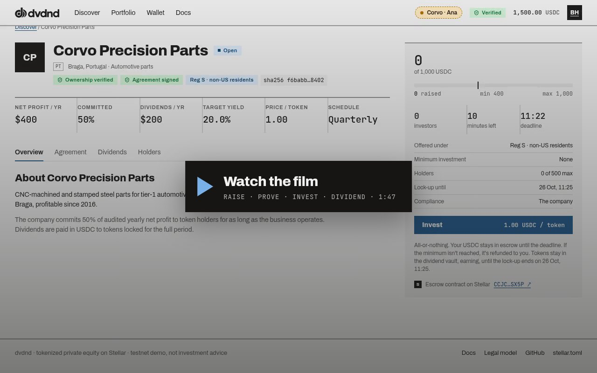
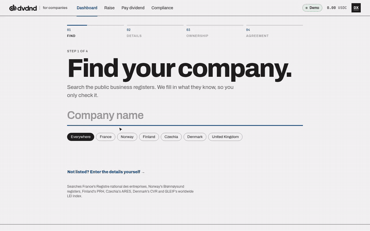
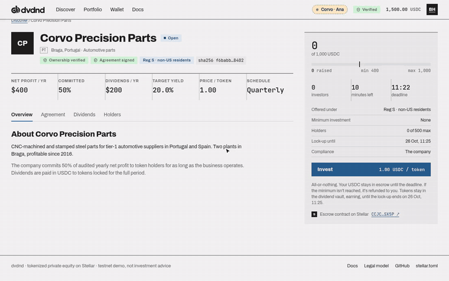
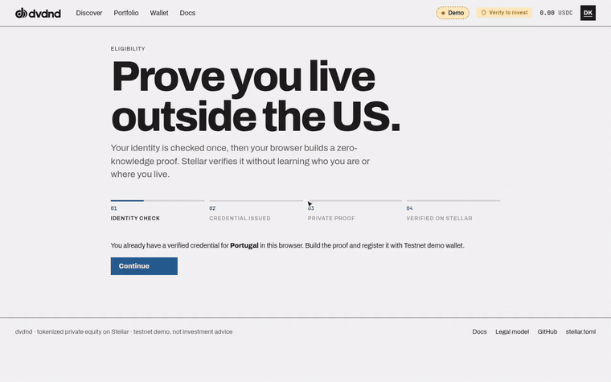
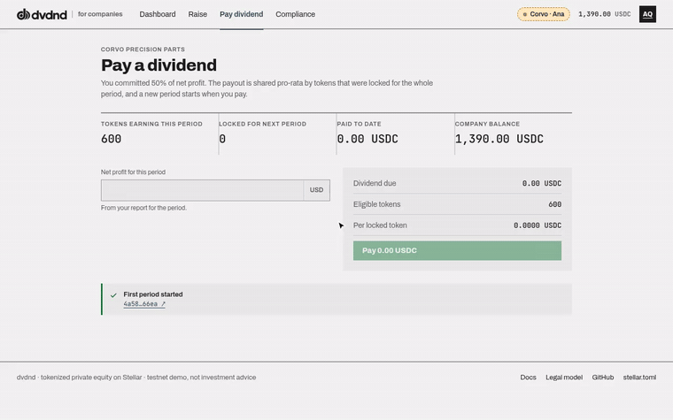
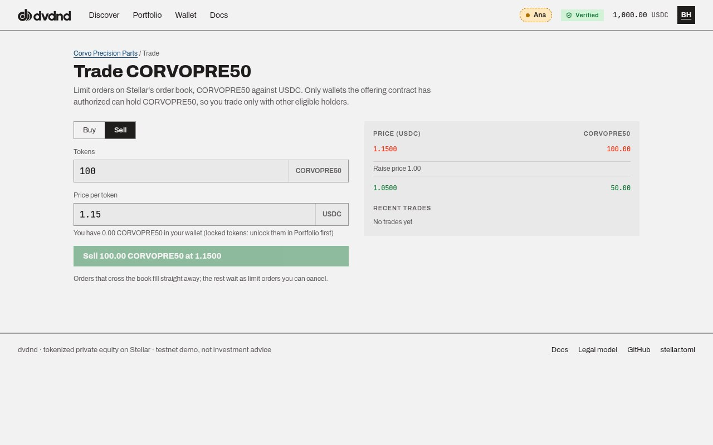
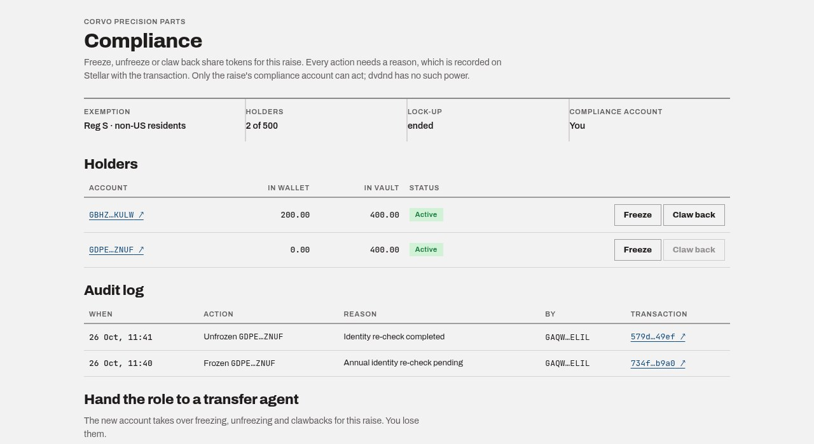

<p align="center">
  
</p>

<h3 align="center">Own a share of real, profitable businesses. Get paid in dollars.</h3>

<p align="center">
  Tokenized private equity on Stellar: fixed-price USDC raises, investors who prove eligibility without revealing who they are, and dividends paid from real profit.
</p>

<p align="center">
  <a href="https://dvdnd.app"><b>Live demo</b></a> ·
  <a href="https://dvdnd.app/docs"><b>Docs</b></a> ·
  <a href="https://www.dvdnd.app/clips/lifecycle.mp4"><b>Watch the 2-minute film</b></a> ·
  <a href="deployments/evidence.md">On-chain evidence</a>
</p>

<p align="center">
  <a href="https://www.dvdnd.app/clips/lifecycle.mp4"></a>
</p>

<p align="center"><sub>Built for HackMeridian · Genesis track · Stellar Unlocked. Running on Stellar testnet.</sub></p>

## Why

Capital keeps moving from public markets into private, cash-flowing businesses, but ordinary investors can't follow it. Crypto's answer so far has been the memecoin launchpad, where about 1% of tokens ever graduate and early buyers pay up to 14.7× less than later ones. Meanwhile established manufacturers and suppliers struggle to raise growth capital without giving up control or taking on debt.

dvdnd connects the two: a company sells a share of its future profit at one fixed price, and only verified investors can ever hold it. Money reaches the company once, at the raise, and comes back to holders as USDC dividends. No bonding curve, no sniper advantage, no buyback. [How dvdnd works →](https://dvdnd.app/docs)

## How it works

### 1. Your profit, on the record

A company finds itself in the public business registers (France, Norway, Finland, Czechia, Denmark, the UK, and GLEIF worldwide) and the details fill in. It proves it controls its domain with one DNS record and signs an agreement committing a share of its profit to token holders; the agreement's hash goes on-chain.



[Listing a company →](https://dvdnd.app/docs/companies)

### 2. One price. All or nothing.

The company opens a raise at a fixed price per token, with a minimum, a maximum and a deadline, under Reg S, Rule 506(c) or both. Investors' USDC waits in escrow: if the minimum is reached the company receives everything, otherwise everyone is refunded. dvdnd charges a flat listing fee, never a share of what is raised.



[Investing in a raise →](https://dvdnd.app/docs/investing)

### 3. Prove where you live. Reveal nothing else.

Investors pass one identity check with Didit. Their browser then builds a Groth16 zero-knowledge proof that they live outside the US, which a Soroban contract verifies with Stellar's BN254 and Poseidon host functions. Stellar learns that they're eligible, not who they are; the Didit session is deleted once the proof is on-chain. US residents take the accredited-investor route instead.



[Proving eligibility →](https://dvdnd.app/docs/verification)

### 4. Paid to the patient.

During the lock-up, claimed tokens sit in the dividend vault, earning. At the end of each period the company pays its committed share of profit in USDC, split among tokens locked for the whole period, so locking just before a payout earns nothing.



[Lock-up and dividends →](https://dvdnd.app/docs/dividends)

### 5. A free market, among the eligible.

After the lock-up, holders trade on Stellar's order book. Each share token is issued with `AUTH_REQUIRED`, `AUTH_REVOCABLE` and `AUTH_CLAWBACK_ENABLED`, so the protocol itself refuses a transfer to any wallet the offering hasn't authorized, on every venue.



[Trading between holders →](https://dvdnd.app/docs/trading)

### 6. Every action leaves a reason.

Each raise names its own compliance account, the company or its transfer agent, which alone can freeze, unfreeze or claw back, always with a recorded reason in an audit log anyone can read.



[Compliance controls →](https://dvdnd.app/docs/compliance)

## No cut. No custody. No gatekeeper.

dvdnd is designed as compliance software rather than a broker (a draft strategy, not legal advice). It takes a flat fee per raise and no transaction-based pay. It never controls investor money: escrowed USDC can only go to the company on success or back to investors on failure. The rules live in the contract: exemption-specific eligibility, the Reg D one-year lock-up and a holder cap below the §12(g) trigger. [Legal model →](https://dvdnd.app/docs/legal)

## Why Stellar

| Protocol feature | How dvdnd uses it |
|---|---|
| **BN254 host functions** (CAP-74/80) | The `gate` contract verifies a Groth16 proof of non-US residence on-chain (`g1_msm` + `pairing_check`). |
| **Poseidon host function** (CAP-75) | The `gate` keeps the credential Merkle tree on-chain and binds the investor's address into the proof. |
| **Classic asset flags** | Share tokens can only be held by wallets the offering authorized, on every venue. |
| **Stellar Asset Contract** | The `offering` contract is the token's admin: it mints exactly what was sold and can never mint again. |
| **Path payments + DEX** | Investors pay with XLM and receive USDC in one operation; secondary trading runs on the order book. |

Five Soroban contracts (`registry`, `gate`, `offering`, `vault`, `timelock`) are administered by a 2-of-3 council multisig behind a timelock. [Contracts and governance →](https://dvdnd.app/docs/governance) · [Architecture](ARCHITECTURE.md)

## Try it

Open **[dvdnd.app](https://dvdnd.app)**. On testnet, the **Demo** menu switches in one click between a ready company (Corvo Precision Parts, an automotive-parts maker) and verified investors in Portugal, Germany and the US, and raises can run in minutes, so a full raise, lock-up and dividend fit in one sitting. You can also connect your own Stellar wallet (xBull, Freighter, Lobstr…) and go through the real identity check.

<details>
<summary><b>Run it locally</b></summary>

Requirements: Rust 1.84+ with the `wasm32v1-none` target, [Stellar CLI](https://developers.stellar.org/docs/tools/cli) 28+, Node 20+, pnpm, and circom 2.2 (only to rebuild the circuit).

```sh
cd contracts && cargo test && stellar contract build      # contracts
cd ../circuits && pnpm install && pnpm fixture            # circuit: sample proof, verified off-chain
cd ../app && cp .env.example .env.local && pnpm install && pnpm dev
```

In `app/.env.local`, set `DVDND_ADMIN_SECRET` (the testnet platform key: `stellar keys show admin`) and, for the identity check, `DIDIT_API_KEY`, `DIDIT_WORKFLOW_ID` and `NEXT_PUBLIC_DIDIT_ENABLED=1`. Contract IDs and endpoints default to testnet (`app/src/lib/config.ts`).

Fresh demo personas, saved to `app/.env.local` as `DEMO_PERSONAS` (run before each demo for a clean slate):

```sh
cd app && npx tsx --conditions=react-server --env-file=.env.local ../scripts/testnet/demo-personas.mts
```

Live tests against testnet, with the app running: `LIVE=1 APP_URL=http://localhost:3000 pnpm vitest run` in `app/`.
</details>

<details>
<summary><b>Deploy the contracts and run the scripted demo</b></summary>

```sh
for k in admin treasury company-andes issuer-andes investor-ana investor-ben; do
  stellar keys generate $k --network testnet --fund
done
scripts/testnet/council.sh                                  # 2-of-3 council
scripts/testnet/deploy.sh                                   # deploy the contracts
scripts/testnet/demo-company.sh ANDES company-andes issuer-andes \
  "Andes Components" 152 5000 300 1000 259200               # issue token, verify, sign, open a Reg S raise
scripts/testnet/demo-investor.sh investor-ana 620 800       # Portugal: credential, ZK proof, USDC
scripts/testnet/demo-investor.sh investor-ben 276 600       # Germany
scripts/testnet/demo-lifecycle.sh ANDES company-andes investor-ana 600 investor-ben 400 80
```
</details>

<details>
<summary><b>Testnet contracts</b></summary>

| Contract | ID |
|---|---|
| registry | [`CCL5K3BT7EKT47SLRIHL23AMKELXPY34WATWMRLKGW2ZWYOALE66Y2TZ`](https://stellar.expert/explorer/testnet/contract/CCL5K3BT7EKT47SLRIHL23AMKELXPY34WATWMRLKGW2ZWYOALE66Y2TZ) |
| gate | [`CBPU52XUHU4UQ3MUBOXITFNHQMOON3SDEWN2IVKPGRCZSQTRTCLGDB7N`](https://stellar.expert/explorer/testnet/contract/CBPU52XUHU4UQ3MUBOXITFNHQMOON3SDEWN2IVKPGRCZSQTRTCLGDB7N) |
| offering | [`CCJCRABWLOEOXVDRHSJXLS5HDOCUCZWY2X2N27NUP24H62N6DKYISX5P`](https://stellar.expert/explorer/testnet/contract/CCJCRABWLOEOXVDRHSJXLS5HDOCUCZWY2X2N27NUP24H62N6DKYISX5P) |
| vault | [`CDU5CGRWVSMFKQWRNJLP5XAKHQAF624QTLUNCONHJ4GQHOZOVAQROHKM`](https://stellar.expert/explorer/testnet/contract/CDU5CGRWVSMFKQWRNJLP5XAKHQAF624QTLUNCONHJ4GQHOZOVAQROHKM) |
| timelock | [`CCHX6UXEPIXLRALJIK2JZWCQ3OLQER7HYOGFVYYYSOP2UJERLEEEGCGZ`](https://stellar.expert/explorer/testnet/contract/CCHX6UXEPIXLRALJIK2JZWCQ3OLQER7HYOGFVYYYSOP2UJERLEEEGCGZ) |
| USDC (Circle testnet) | [`CBIELTK6YBZJU5UP2WWQEUCYKLPU6AUNZ2BQ4WWFEIE3USCIHMXQDAMA`](https://stellar.expert/explorer/testnet/contract/CBIELTK6YBZJU5UP2WWQEUCYKLPU6AUNZ2BQ4WWFEIE3USCIHMXQDAMA) |

Every transaction of a complete testnet cycle (ZK eligibility, raise, listing fee, claims into the vault under lock-up, a dividend split by locked amount) is linked in [deployments/evidence.md](deployments/evidence.md).
</details>

## Repository

| Path | Contents |
|---|---|
| [`contracts/`](contracts/) | Soroban contracts in Rust (soroban-sdk 28) |
| [`circuits/`](circuits/) | Circom residence circuit, trusted-setup ceremony and prover |
| [`app/`](app/) | Next.js app: investor and company flows, docs, wired to the testnet contracts |
| [`scripts/testnet/`](scripts/testnet/) | Deploy, demo and persona scripts |
| [`deployments/`](deployments/) | Contract IDs and transaction evidence |
| [`research_notes/`](research_notes/), [`reports/`](reports/) | The research behind the design |

## Built during HackMeridian

Everything here was built during the event, starting 25 October 2026: research, contracts, circuit, scripts and app. No prior code was reused. The circuit's trusted setup uses the public PSE Powers of Tau and a recorded phase-2 ceremony ([transcript](circuits/ceremony/TRANSCRIPT.md)) with one contributor so far; more independent contributors are needed before production.

MIT licensed.
